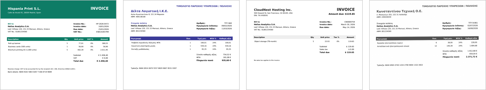
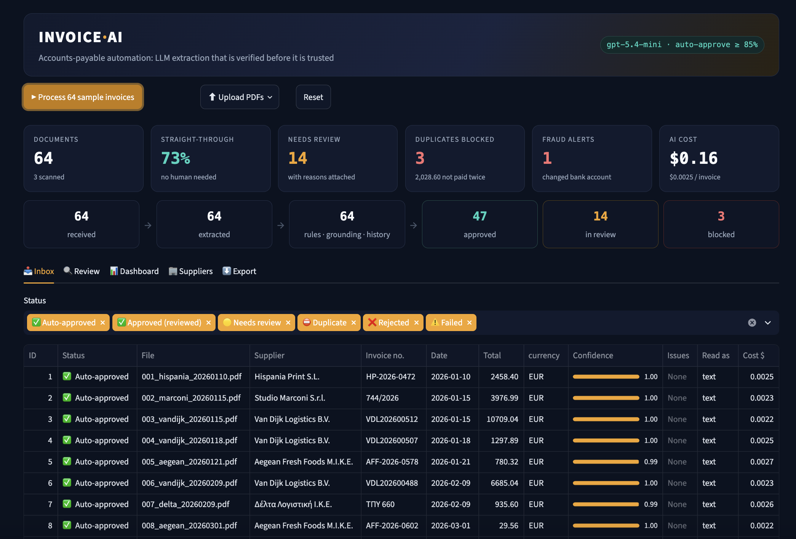
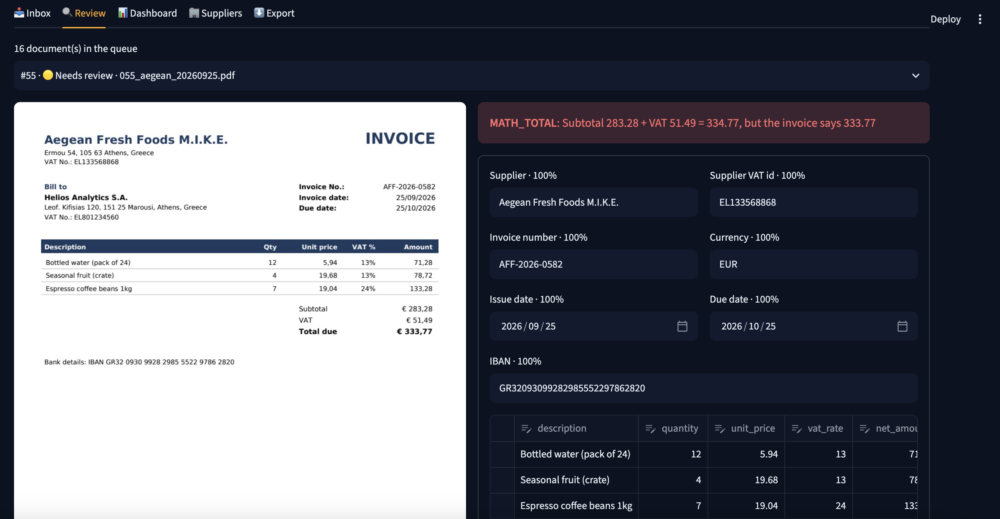
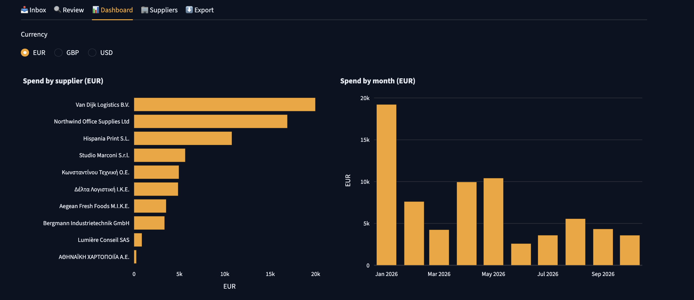
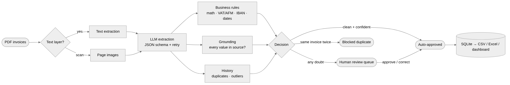

# 🧾 Invoice AI: accounts-payable automation with verified LLM extraction

**Turns a folder of supplier invoices (PDFs, scans, English and Greek) into clean, validated accounting data. It auto-approves only what it can verify and routes everything else to a human with the reason attached.**

Most "AI invoice parsers" stop at *the LLM returned some JSON*. In finance that isn't enough, because a single misread digit in a total or an IBAN costs real money. This pipeline treats the LLM as a fast but fallible reader and wraps it in the checks an accounts-payable team actually needs:

- **Business rules**: line math, subtotal + VAT = total, VAT number formats, **Greek ΑΦΜ checksum**, **IBAN mod-97**, date logic, invoice addressed to us.
- **Grounding**: every extracted value must literally appear in the PDF text, in any locale format (`1.234,56` / `1,234.56` / `12 March 2026`). If it doesn't, it is flagged as a possible hallucination.
- **History and fraud checks**: duplicate invoices, near-duplicates (same supplier, same amount, days apart), amount outliers, and **changed bank accounts**. A supplier that suddenly asks to be paid into a different IBAN is the most common invoice-fraud pattern.
- **Human-in-the-loop**: a review queue with the PDF side by side, editable fields, per-field confidence and a log of every correction.

<p align="center"></p>
<p align="center"><sub>Part of the labelled sample set: EU reverse-charge invoice · Greek invoice (ΦΠΑ 24%) · US invoice in USD · <b>scanned</b> invoice with no text layer</sub></p>

<p align="center"></p>
<p align="center"><sub>64 invoices processed in one live run: 73% straight-through, 14 sent to review with the reason attached, 3 duplicates blocked, 1 changed bank account flagged as fraud · $0.0025 per invoice</sub></p>

<details>
<summary><b>More screenshots</b>: review queue, dashboard</summary>
<br>

**Review queue**: the PDF next to the extracted fields with per-field confidence. Here the supplier's own total is wrong (283.28 + 51.49 ≠ 333.77), so it is held for a human.



**Dashboard**: spend by supplier and by month, per currency.



</details>

---

## Results

Evaluated on **64 labelled invoices** (12 suppliers, 9 countries, 4 layouts, English and Greek, 3 scans) with **16 deliberately planted problems**:

<!-- EVAL_RESULTS -->

The metric that matters most is **unsafe approvals**: documents auto-approved while wrong or problematic. The design goal is zero, so that everything uncertain goes to a human.

## How it works

<p align="center"></p>

| Step | What happens | Why |
|---|---|---|
| **Read** | `pypdf` text layer. If a page has no text (a scan), it is rendered to an image with `pypdfium2` | Text is cheap and verifiable, and scans still work |
| **Extract** | The LLM returns JSON for a **Pydantic schema** (supplier, customer, lines, totals, IBAN…) plus a confidence per field. Schema errors are sent back for a self-correction | Typed, validated output, not free text |
| **Validate** | Arithmetic, identifier checksums, dates, addressee | Catches supplier mistakes and model misreads |
| **Ground** | Every value is searched in the source text in all locale formats | Catches hallucinated values |
| **History** | Same supplier + number → **duplicate** (blocked). Same supplier + amount within 14 days → near-duplicate. More than 4× the supplier's median → outlier. **IBAN not among the supplier's trusted accounts → fraud alert** | Prevents double payments and payment fraud |
| **Decide** | **Auto-approve** only if there are no issues, the document is text-verified and confidence ≥ 85%. Scans always go to review | Safe automation |
| **Review** | Streamlit queue: PDF preview, issues, editable fields with confidence, approve / reject; corrections are logged | Humans handle the exceptions, and the log shows where the AI is weakest |
| **Export** | CSV / Excel (invoices + line items), spend dashboard | Ready for ERP import or Power BI |

Processing is **idempotent**: files are tracked by SHA-256, so the same inbox can be re-run safely.

## The sample data

`samples/invoices/` holds 64 synthetic but realistic PDFs generated by `invoiceai/synth/generate.py`, with ground truth in `samples/ground_truth.json`:

- **12 suppliers**: Greek (ΑΦΜ, ΦΠΑ 24% / 13%, Greek-language invoices), EU (reverse charge, Art. 196), UK (outside scope of VAT), US (no sales tax, EIN)
- **Local formats**: `1.234,56 €`, `€ 1,234.56`, `1 234,56`; `12/03/2026`, `12.03.2026`, `12 March 2026`, `March 12, 2026`
- **Planted problems**: 3 arithmetic errors, 2 invalid VAT numbers / AFM checksums, 2 invalid IBANs, **1 changed bank account (fraud)**, 3 duplicates (re-sent with a "COPY" stamp), 1 near-duplicate, 1 amount outlier, 3 scans

All companies, numbers and IBANs are fictional.

## Quickstart

Requires Python 3.10+ and an OpenAI API key.

```bash
python3 -m venv .venv && source .venv/bin/activate
pip install -r requirements.txt
cp .env.example .env              # add your OPENAI_API_KEY
python scripts/check_openai.py

python -m streamlit run app.py    # then click "▶ Process 64 sample invoices"
```

Command line:

```bash
python -m invoiceai.pipeline samples/invoices          # process a folder (or a single PDF)
python -m invoiceai.eval.run_eval                      # full evaluation → eval_results/
python -m invoiceai.synth.generate --n 100 --seed 7    # regenerate / enlarge the sample set
python -m pytest -q                                    # 46 offline tests, no API key needed
```

## Tests

The tests run without an API key, using an "oracle" LLM that returns the ground truth. They verify that:

- every planted problem is caught, with no false alarms on clean invoices and **zero unsafe approvals**
- a misread digit in the total is never auto-approved (it is caught by both arithmetic and grounding)
- a valid but unknown IBAN from a known supplier raises a fraud alert
- scans are read with vision and always go to review
- schema errors are fed back and fixed, and processing is idempotent
- reviewer corrections are logged field by field
- AFM / IBAN / VAT checksums and locale-aware number parsing work as intended

## Project structure

```
├── app.py                      # Streamlit: inbox, review queue, dashboard, suppliers, export
├── invoiceai/
│   ├── schema.py               # Pydantic invoice model
│   ├── pdf.py                  # text layer or page images (scans)
│   ├── extract.py              # LLM extraction with schema validation + retry
│   ├── validate.py             # business rules, grounding, confidence, decision
│   ├── identifiers.py          # VAT formats, Greek AFM checksum, IBAN mod-97
│   ├── normalize.py            # locale-aware number/date formats
│   ├── store.py                # SQLite, supplier master, duplicates, outliers, IBAN-change checks, review log
│   ├── pipeline.py             # batch processing (CLI)
│   ├── synth/generate.py       # labelled synthetic invoice generator
│   └── eval/run_eval.py        # field accuracy, issue recall, STP, unsafe approvals, cost
├── samples/                    # 64 PDFs + ground truth
└── tests/                      # 46 offline tests
```

## Production notes

- **Data residency**: swap `OpenAIClient` (`invoiceai/llm.py`) for Azure OpenAI in the client's tenant or a self-hosted model. The rest is unchanged.
- **Scaling**: the pipeline is stateless per document. Run it from a queue (e.g. Azure Functions or Data Factory) and move SQLite to PostgreSQL / SQL Server.
- **Learning loop**: the `corrections` table shows which fields reviewers fix most. Feed those into the prompt as examples, or add a rule.

## Tech stack

Python · OpenAI API (text + vision) · Pydantic · pypdf · pypdfium2 · SQLite · Streamlit · Plotly · reportlab · pytest

---

Built by **Adam Diamantidis**, Data Engineer (data pipelines, SQL, Azure, Power BI) and MSc Applied Data Science, Utrecht University. See also: [Loan Portfolio AI Copilot](https://github.com/AdamDiam/loan-portfolio-copilot) (text-to-SQL + RAG over EBA/ECB regulation).
